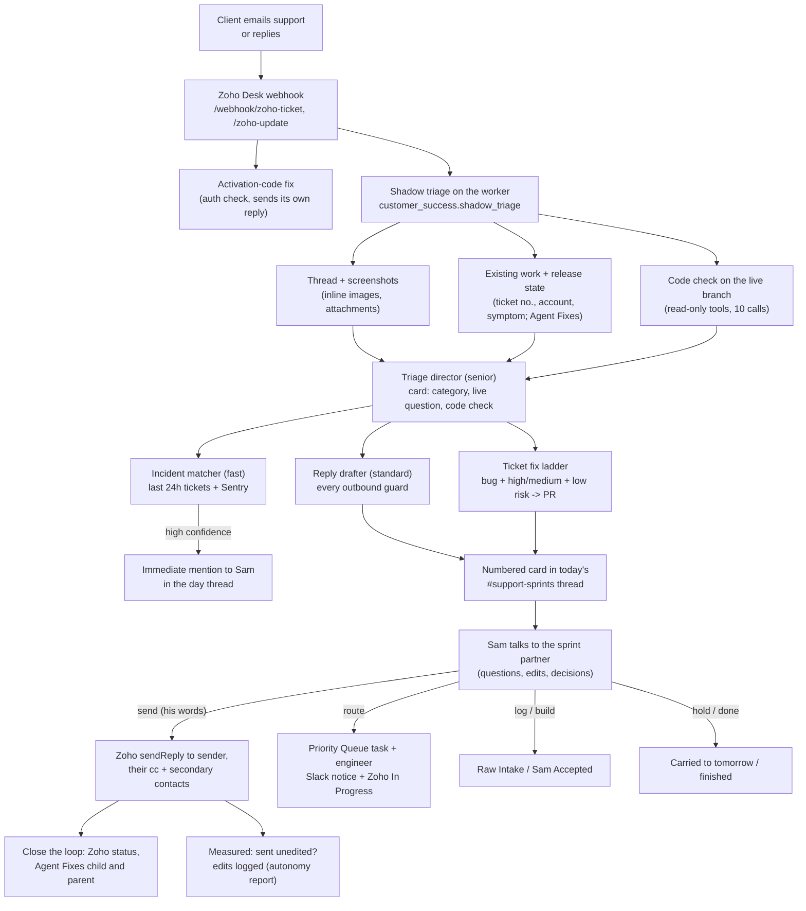
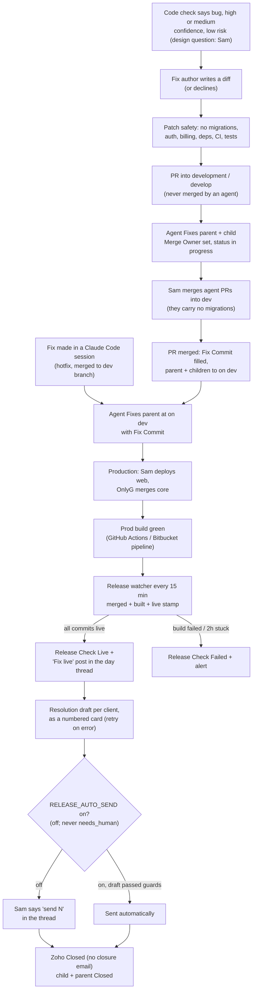
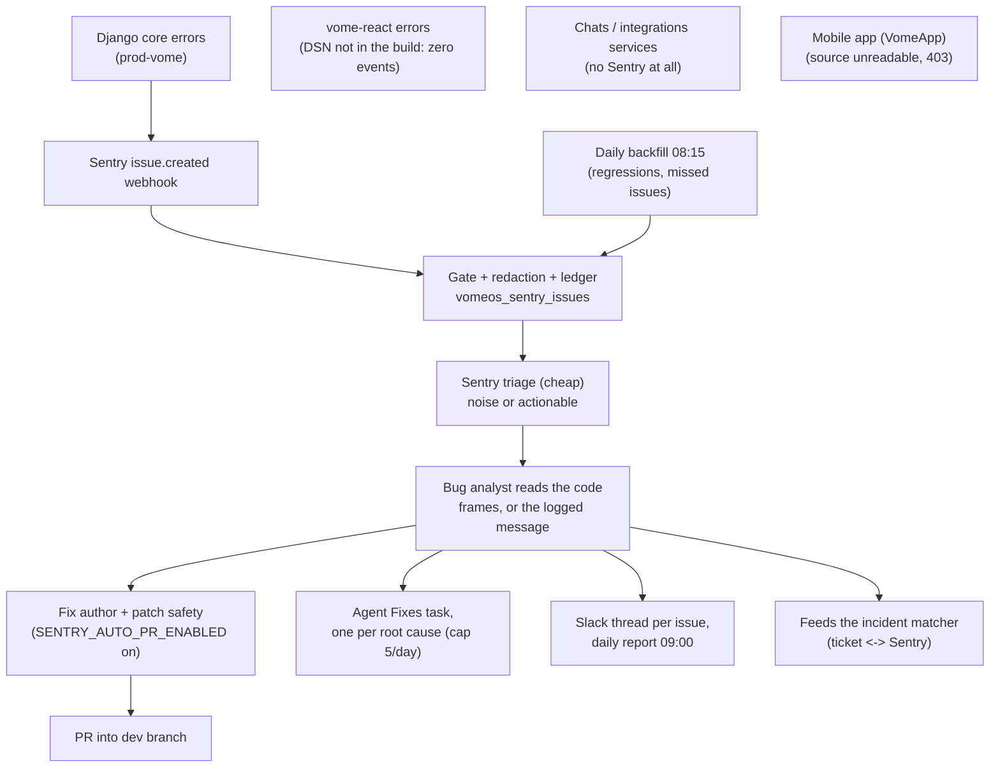
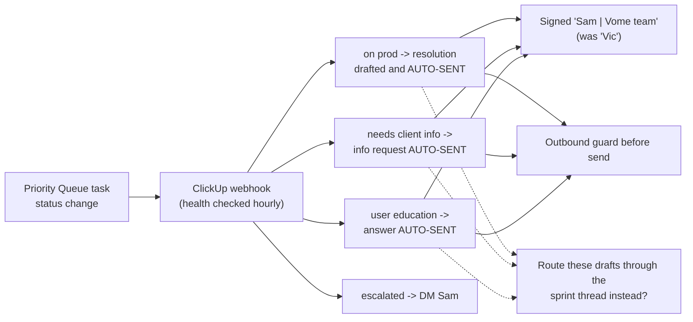
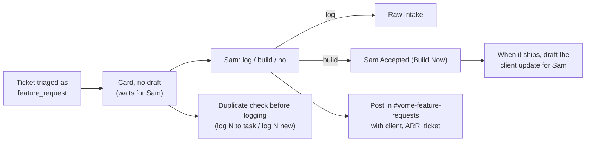
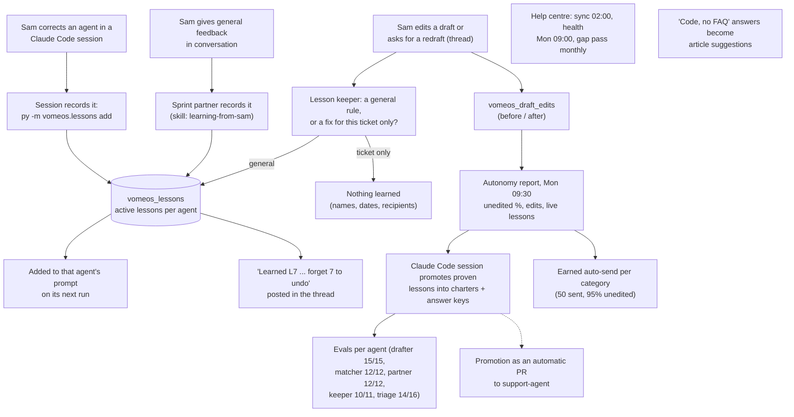
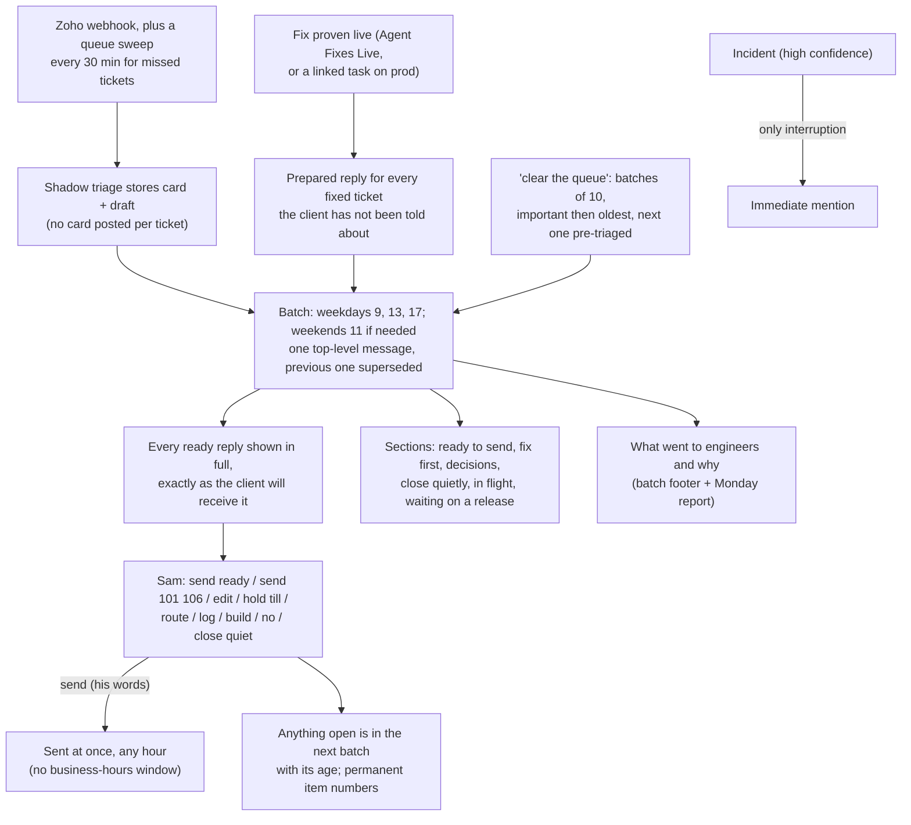

# Vome support agent: workflow map

**Source of truth for how customer success runs end to end.** Every box in
every diagram carries a status class, and every non-live box has a row in the
gap register at the bottom. The published map is generated from this file:

    py scripts/render_workflow_map.py      # writes workflow_map.html

Published map (republish the generated file to this URL, never a new one):
https://claude.ai/artifact/3a7sh6MMwjQ9X2LtJbh2Go

To propose a change: edit a diagram or add a register row, set its status,
and regenerate. A new AI session should read this file, `CLAUDE.md`, and the
ClickUp handoff page (doc 3dztm-3311, page 3dztm-6351) before acting.

**As of:** 2026-10-18

## Status key

| Class | Meaning |
|---|---|
| `live` | Running in production and proven on real traffic |
| `deployed` | Pushed and running, not yet proven on a real case |
| `built` | Written and tested locally, not pushed yet |
| `proposed` | Agreed or recommended, not built |
| `broken` | Broken, blind, or at risk of breaking |
| `decide` | Waiting on a decision from Sam |

<!-- map:diagram id=ticket title="1. A ticket, from email to closed" -->

<!-- map:diagram id=fix title="2. A bug, from code check to customer told" -->

<!-- map:diagram id=sentry title="3. A production error, from Sentry to a fix" -->

<!-- map:diagram id=engineer title="4. Engineer-triggered replies (ClickUp status changes)" -->

<!-- map:diagram id=feature title="5. A feature request" -->

<!-- map:diagram id=learning title="6. Every correction teaches the agents" -->

<!-- map:diagram id=director title="7. Sprint batches in Slack (deployed 2026-10-18, schedule paused: Sam runs sprints in Claude.ai, see G34)" -->

## Schedule (America/Montreal, run by Celery beat on `vome-os-worker`)

| When | Job | Status |
|---|---|---|
| every 15 min | `support.release_watcher` (also promotes merged fix PRs and drafts resolutions) | live |
| hourly :30 | `support.clickup_webhook_health` | live |
| 02:00 daily | `support.kb_sync` | live |
| 07:30 daily | `support.stale_sweep` | live |
| 08:00 daily | `engineering.code_access` (credential watch) | live |
| 08:15 daily | `engineering.sentry_backfill` | deployed |
| 08:30 daily | `engineering.sentry_regate` | live |
| 09:00 daily | `engineering.sentry_report` | live |
| 10, 13, 16, 19 weekdays | `support.sprint_update` (retired Oct 18, replaced by batches) | built |
| 9, 13, 17 weekdays; 11 Sat and Sun if needed | `support.sprint_batch` (+ `support.sprint_batch_weekend`) | deployed |
| every 30 min | `support.queue_sweep` (G26) | deployed |
| 17:00 daily | `support.daily_digest` | live |
| Mon 07:00, Fri 16:45 | engineering reports | live |
| Mon 09:30 | `support.autonomy_report` | built |
| Mon 09:00 | `support.kb_health_scan` | live |
| Sun 03:00 | `support.knowledge_refresh` | live |
| 1st Tue 09:00 | `support.kb_gap_pass` | live |

Events (on the worker): `customer_success.shadow_triage` (Zoho webhooks),
`customer_success.sprint_command` (Sam's thread messages),
`engineering.sentry_issue` (Sentry webhook).

## Gap register

<!-- map:register -->
| id | area | item | status | why it matters | next step | owner |
|---|---|---|---|---|---|---|
| G1 | release | Resolution drafts made automatically when a fix goes Live | live | Proven Oct 17: #9436 and #9500 drafted on the retry; #9415 held by a guard for the word placeholders | None; the guard match on placeholders is worth narrowing | agent |
| G21 | release | Auto-send resolutions once a fix is proven live (`RELEASE_AUTO_SEND`) | decide | Removes the last manual step for clean resolutions | Turn on once the Monday autonomy report shows resolutions going out unedited; never applies to needs_human | Sam |
| G2 | engineer | Engineer-triggered replies still auto-send (on prod, needs client info, user education) | decide | They skip Sam's review; the playbook text says nothing auto-sends | Keep as is, or turn them into sprint thread drafts | Sam |
| G3 | intake | Legacy intake (classifier, CRM tier, Zoho auto-assignment, ClickUp queue task, #vome-tickets brief) and the blind auto-ack removed | deployed | Two cards per ticket, and a second ClickUp task whenever Sam routed one | Push; new tickets then reach engineers only through `route`. Reply handling is unchanged | Sam |
| G32 | intake | Activation-code fix still emails the client on its own | decide | The one new-ticket reply that skips Sam's review | Keep (it fixes the login in seconds), or turn it into a sprint thread draft | Sam |
| G4 | sentry | vome-react sends nothing to Sentry | broken | Frontend crashes reach us only as tickets | Put REACT_APP_SENTRY_DSN into the build (CRA inlines it at build time) | Sanjay |
| G5 | sentry | Chats and integrations services have no Sentry | broken | Their errors are invisible | Add the SDK to both services | OnlyG |
| G6 | code | Mobile source is unreadable (VomeApp 403) | deployed | Code checks cannot read the app | VomeApp moved to vomeadmin; all GitHub reads use `vome-os-sentry-write-web`, `mobile=` added to the default repo map. Live on push | Sam |
| G7 | creds | vomeadmin GitHub token expires 2026-10-31 | broken | Release watcher web checks and web code reads stop | Renew, update VOMEOS_GITHUB_TOKEN_VOMEADMIN on worker and web | Sam |
| G8 | data | content_mode email failures (Oct 15 20:11 to Oct 16 16:01 UTC) | broken | Some birthday, bulk and enrollment emails may not have sent | Confirm it stopped; count what failed; add db_default on new NOT NULL columns | OnlyG |
| G9 | feature | Feature requests are not posted to #vome-feature-requests | built | Sam's single list of decisions misses them | Push; every log/build posts with client, tier/ARR and ticket | agent |
| G10 | feature | No duplicate check before logging a feature request | built | Risk of duplicate backlog items | Push; `log N` stops on a possible duplicate, `log N to <task>` adds the client, `log N new` logs anyway | agent |
| G11 | feature | Client not told when a Sam Accepted request ships | built | Promise loop never closes | Push; hourly `support.shipped_untold` drafts the update when a Sam Accepted task closes | agent |
| G12 | incident | Incident alert does not create the fix parent with one child per ticket | proposed | Grouping is manual | On a confirmed incident, create the parent and children | agent |
| G13 | learning | Every correction becomes a live lesson (thread edits, conversation, Claude Code) | deployed | The same correction kept coming back | L1 recorded 2026-10-18 (triage: bug vs how-to vs design question); first thread edit still to come | Sam |
| G22 | learning | Lesson promotion into charters is done by hand weekly | proposed | Live lessons pile up if nobody promotes them | Have the Monday job open a PR with the proposed charter and answer-key changes | agent |
| G14 | learning | Earned auto-send per category | proposed | The goal state; needs data first | After 50 sent at 95% unedited, Sam approves a category | Sam |
| G15 | triage | Triage answer key was written by an agent, not reviewed | broken | 2026-10-18: 14/17 (82%), under the 85% threshold, the same with or without the new skill. Misses: tri-04 (feature_request vs needs_human), tri-13 (vague_bug vs clear_bug), tri-16 (vague/user_education vs admin_action) | Sam reviews the 17 cases once; fix the key or the charter | Sam |
| G16 | docs | CLAUDE.md "state of play" predates the broker cutover | built | New sessions start from wrong facts | Refreshed 2026-10-17 (see CLAUDE.md) | agent |
| G17 | crm | CRM often finds no deal, so ARR shows 0 and tier "low" | broken | Important clients can look unimportant on cards | Map Zoho account to CRM account, not only by email | agent |
| G18 | knowledge | "Source: code, no FAQ" answers do not become article suggestions | proposed | The same question is answered from code each time | Queue a help centre article draft for Sam | agent |
| G19 | slack | First real message in the sprint thread not yet proven | deployed | If Slack does not deliver thread events, Sam's replies go nowhere | Sam replies in the thread once; check the agent answers | Sam |
| G23 | director | Batches replace per-ticket cards and the 10/1/4/7 day thread (weekdays 9, 13, 17; weekends 11 if needed) | deployed | Sam scrolled cards to act; updates listed items without the drafts | First scheduled batch Mon Oct 19 9:00, or `catch me up` in a sprint thread | agent |
| G24 | director | Permanent item numbers across days | deployed | Carried items got new numbers and their cards stayed in yesterday's thread | Prove on the first weekday batch | agent |
| G25 | director | Clear-the-queue mode | deployed | 44 open on Oct 17 with only 2 carded | Rounds of 25, most important then oldest; `clear the queue` in a batch thread | agent |
| G26 | intake | Queue sweep every 30 min replaces the 8-per-update backfill | deployed | A missed webhook left a ticket invisible until a weekday update | First sweep ran Oct 18 12:30 ET; 10 tickets per run | agent |
| G27 | director | What still goes to engineers, and why | built | Sam cannot see how much escalates or what would prevent it | Push; triage sets lane and escalation_reason (skill choosing-the-lane), routes record it, batch footer and Monday report show it | agent |
| G28 | learning | Trust tiers per category (order and report only) | built | Proven categories should need less of Sam | Push; Monday report labels each category proven / learning; drafts are always shown in full | agent |
| G29 | director | `close quiet` housekeeping lane | built | "Thanks, works now" and handled error reports still take a decision each | Push; housekeeping lane gets no draft, batch shows CLOSE QUIETLY, `close quiet` / `close N` close in Zoho with no email | agent |
| G31 | release | Every fixed ticket the client was not told about gets a prepared reply | built | Fixes ship and the client never hears (Oct 9: six closed tasks came back) | Push; hourly `support.shipped_untold` drafts a resolution for Priority Queue `on prod` tasks with no reply since | agent |
| G33 | fix | Ticket bugs become fix PRs on their own | deployed | Never fired before Oct 18: it needed high confidence (0 of 16 cards) and VOMEOS_CODE_WRITE_REPOS was unset, so no repo was writable (Sentry PRs too) | Gate is now medium; allowlist set Oct 18 (core, database, web). Watch for the first PR | agent |
| G34 | director | Sprints run in Claude.ai through the Vome OS connector | built | Sam works sprints in Claude.ai (2026-10-18); Slack batches paused until he wants them back (SPRINT_BATCHES_ENABLED) | Push; paste handoffs/CLAUDE_AI_SPRINT_PROMPT.md into the Claude.ai project; tools sprint_queue, ticket_first_pass, fix_status, sprint_followups, propose_fix, send_ticket_reply, route_ticket, close_ticket_quietly, log_ticket_request, teach_agents | Sam |
| G20 | items 1-5 | Close the loop, code checks, ticket fixes, autonomy report, Sam signature, resolution drafts | deployed | Pushed Oct 17/18 | Prove each on a real ticket | agent |
