# Vome support agent: workflow map

**Source of truth for how customer success runs end to end.** Every box in
every diagram carries a status class, and every non-live box has a row in the
gap register at the bottom. The published map is generated from this file:

    py scripts/render_workflow_map.py      # writes workflow_map.html

Published map (republish the generated file to this URL, never a new one):
https://claude.ai/artifact/3a7sh6MMwjQ9X2LtJbh2Go

To propose a change: edit a diagram or add a register row, set its status,
and regenerate. A new AI session should read this file, `CLAUDE.md`, and the
ClickUp handoff page (doc 3dztm-3311, page 3dztm-6351) before acting.

**As of:** 2026-10-23

## Status key

| Class | Meaning |
|---|---|
| `live` | Running in production and proven on real traffic |
| `deployed` | Pushed and running, not yet proven on a real case |
| `built` | Written and tested locally, not pushed yet |
| `proposed` | Agreed or recommended, not built |
| `broken` | Broken, blind, or at risk of breaking |
| `decide` | Waiting on a decision from Sam |

<!-- map:diagram id=ticket title="1. A ticket, from email to closed" -->
```mermaid
flowchart TD
  A["Client emails support<br/>or replies"]:::live --> B["Zoho Desk webhook<br/>/webhook/zoho-ticket, /zoho-update"]:::live
  B --> AC["Activation-code fix<br/>(auth check, sends its own reply)"]:::live
  B --> S["Shadow triage on the worker<br/>customer_success.shadow_triage"]:::deployed
  S --> S1["Thread + screenshots<br/>(inline images, attachments)"]:::deployed
  S --> S2["Existing work + release state<br/>(ticket no., account, symptom; Agent Fixes)"]:::deployed
  S --> S3["Code check on the live branch, 25 calls<br/>grep + find on full copies of all 6 repos, read_task"]:::built
  S1 & S2 & S3 --> T["Triage director (senior)<br/>card: category, live question, code check"]:::deployed
  T -->|"unsure, engineer / sam_ops lane,<br/>or important client"| DP["Triage investigator (deep pass)<br/>60 calls, challenges the card; its card replaces it"]:::built
  DP --> I
  T --> I["Incident matcher (fast)<br/>last 24h tickets + Sentry"]:::deployed
  I -->|high confidence| IA["Immediate mention to Sam<br/>in the day thread"]:::deployed
  T --> D["Reply drafter (standard)<br/>every outbound guard"]:::deployed
  T --> F["Ticket fix ladder<br/>bug + high/medium + low risk -> PR"]:::deployed
  D & F --> C["Numbered card in today's<br/>#support-sprints thread"]:::deployed
  C --> P["Sam talks to the sprint partner<br/>(questions, edits, decisions)"]:::deployed
  P -->|"send (his words)"| SE["Zoho sendReply to sender,<br/>their cc + secondary contacts"]:::deployed
  SE --> CL["Close the loop: Zoho status,<br/>Agent Fixes child and parent"]:::built
  P -->|route| R["Priority Queue task + engineer<br/>Slack notice + Zoho In Progress"]:::deployed
  P -->|log / build| FR["Raw Intake / Sam Accepted"]:::deployed
  P -->|hold / done| H["Carried to tomorrow / finished"]:::deployed
  SE --> M["Measured: sent unedited?<br/>edits logged (autonomy report)"]:::built
```

<!-- map:diagram id=fix title="2. A bug, from code check to customer told" -->
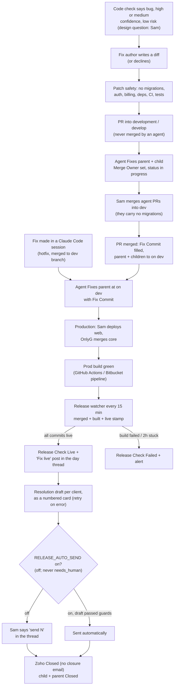

<!-- map:diagram id=sentry title="3. A production error, from Sentry to a fix" -->
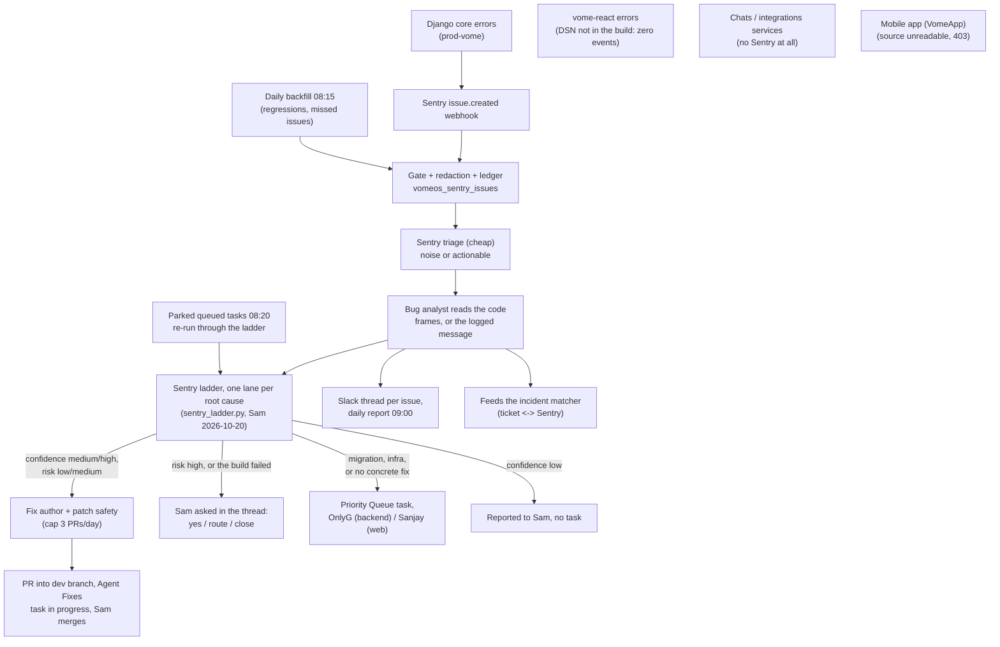

<!-- map:diagram id=engineer title="4. Engineer-triggered replies (ClickUp status changes)" -->
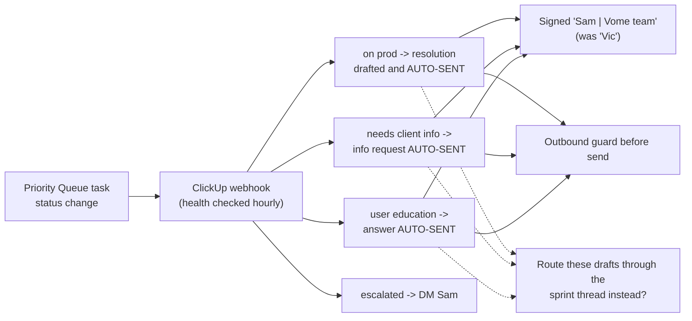

<!-- map:diagram id=feature title="5. A feature request" -->
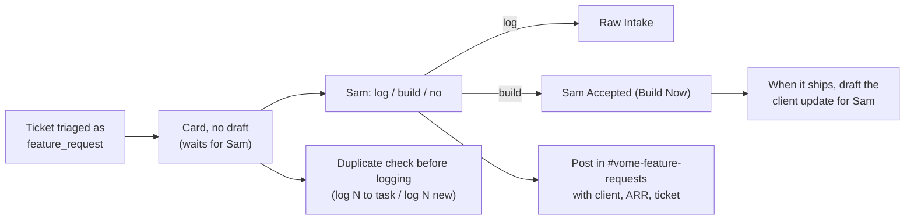

<!-- map:diagram id=learning title="6. Every correction teaches the agents" -->
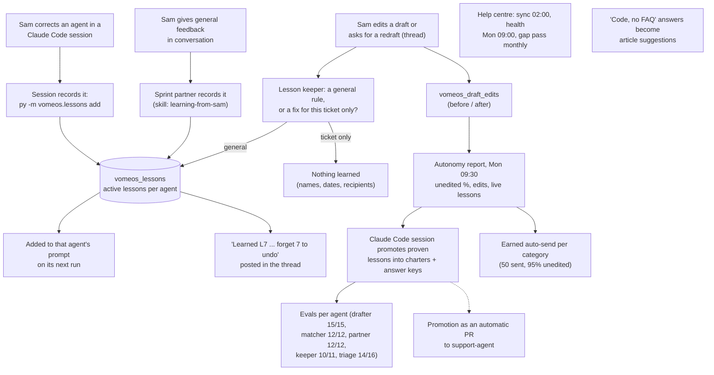

<!-- map:diagram id=director title="7. Sprint batches in Slack (deployed 2026-10-18, schedule paused: Sam runs sprints in Claude.ai, see G34)" -->
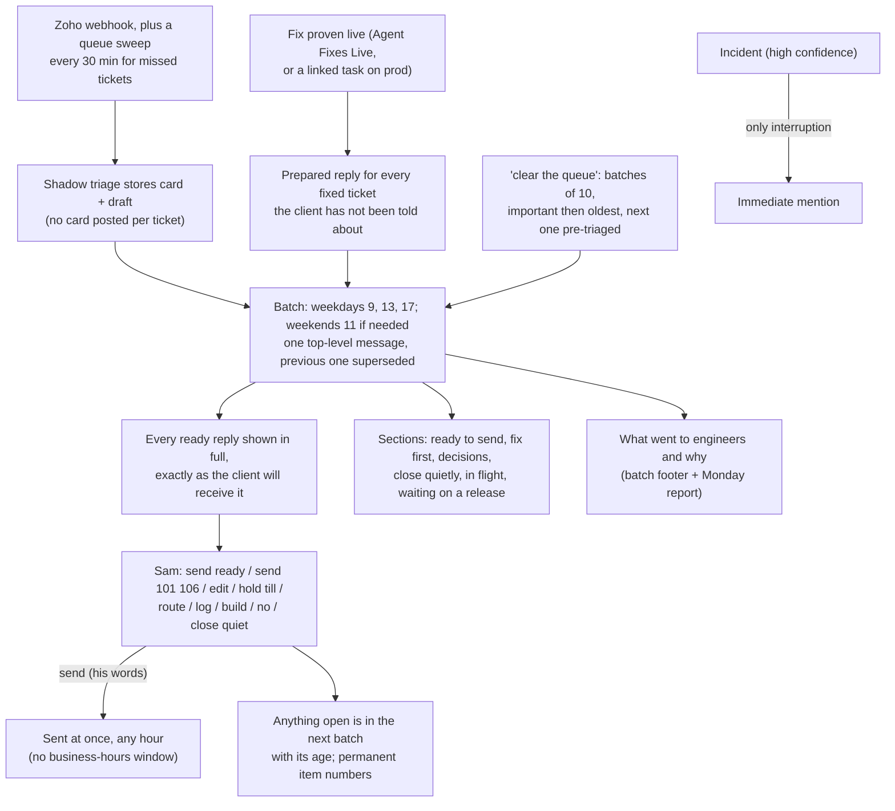

<!-- map:diagram id=bugreports title="8. A teammate's bug report in #bug-reports (built 2026-10-19)" -->
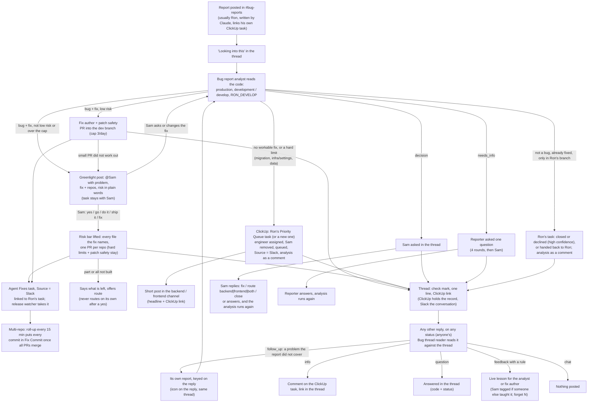

<!-- map:diagram id=featuredesk title="9. A request in #feature-requests, shaped before it is built (built 2026-10-19, switched off)" -->
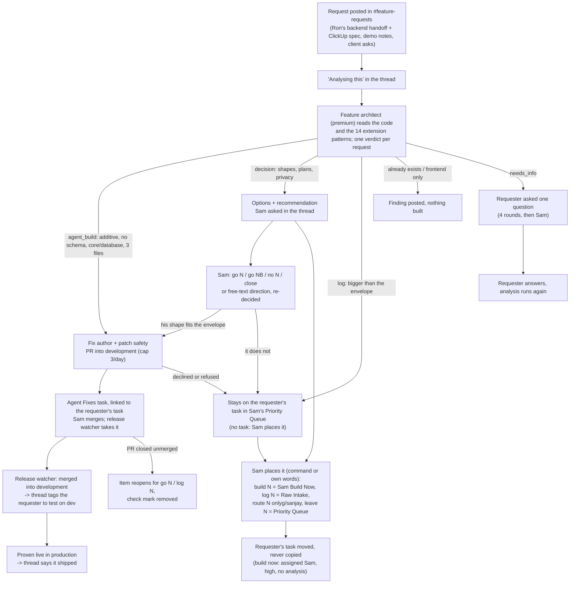

<!-- map:diagram id=worklog title="10. Log this on ClickUp: Sam and Ron's Agent Workflows list (built 2026-10-19)" -->
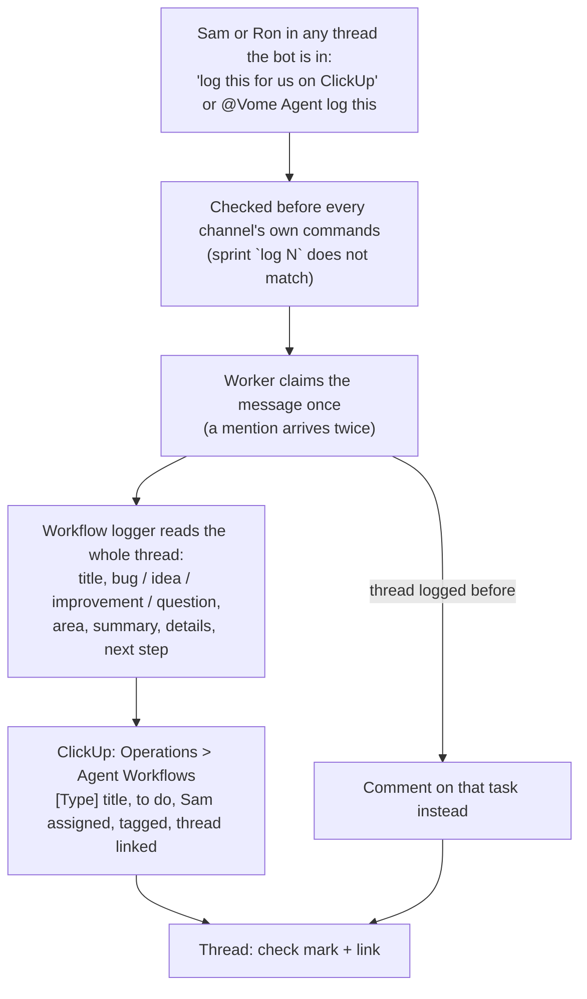

<!-- map:diagram id=video title="11. A marketing video, from idea in #video-studio to a link on Sam's phone (deployed 2026-10-18, full reference: VIDEO_STUDIO.md)" -->
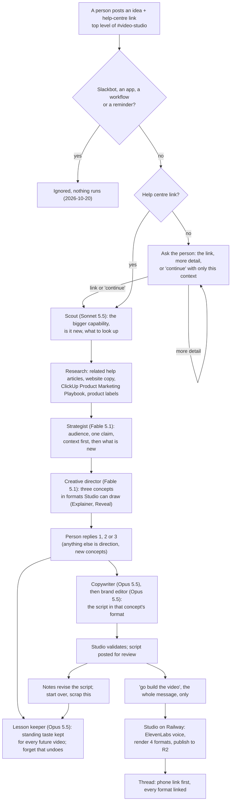

<!-- map:diagram id=reconcile title="12. In Progress tickets, reconciled with ClickUp every night (built 2026-10-23)" -->
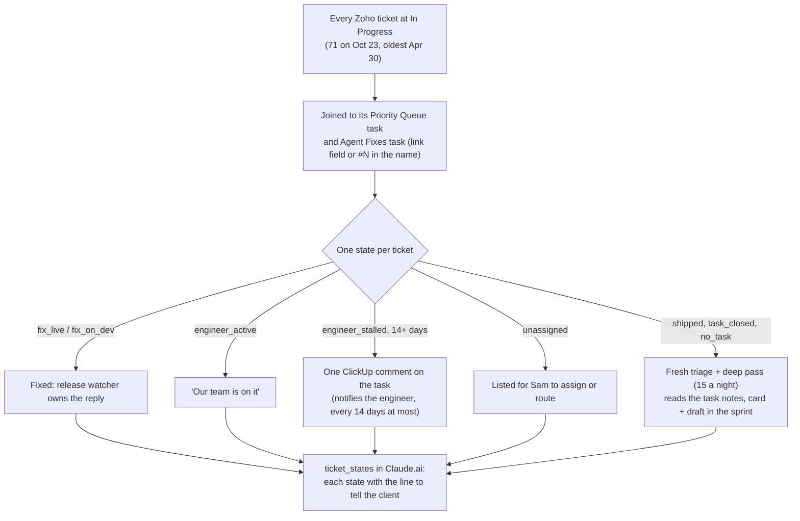

## Schedule (America/Montreal, run by Celery beat on `vome-os-worker`)

| When | Job | Status |
|---|---|---|
| every 15 min | `support.release_watcher` (also promotes merged fix PRs and drafts resolutions) | live |
| hourly :30 | `support.clickup_webhook_health` | live |
| 02:00 daily | `support.kb_sync` | live |
| 07:30 daily | `support.stale_sweep` | live |
| 08:00 daily | `engineering.code_access` (credential watch) | live |
| 08:15 daily | `engineering.sentry_backfill` | deployed |
| 08:30 daily | `engineering.sentry_regate` | live |
| 09:00 daily | `engineering.sentry_report` | live |
| 10, 13, 16, 19 weekdays | `support.sprint_update` (retired Oct 18, replaced by batches) | built |
| 9, 13, 17 weekdays; 11 Sat and Sun if needed | `support.sprint_batch` (+ `support.sprint_batch_weekend`) | deployed |
| every 30 min | `support.queue_sweep` (G26) | deployed |
| hourly :05 | `support.code_copies` (full copy of each repo at its live commit) | built |
| 06:30 daily | `support.ticket_reconcile` (In Progress tickets vs ClickUp) | built |
| 17:00 daily | `support.daily_digest` | live |
| Mon 07:00, Fri 16:45 | engineering reports | live |
| Mon 09:30 | `support.autonomy_report` | built |
| Mon 09:00 | `support.kb_health_scan` | live |
| Sun 03:00 | `support.knowledge_refresh` | live |
| 1st Tue 09:00 | `support.kb_gap_pass` | live |

Events (on the worker): `customer_success.shadow_triage` (Zoho webhooks),
`customer_success.sprint_command` (Sam's thread messages),
`engineering.sentry_issue` (Sentry webhook).

## Gap register

<!-- map:register -->
| id | area | item | status | why it matters | next step | owner |
|---|---|---|---|---|---|---|
| G1 | release | Resolution drafts made automatically when a fix goes Live | live | Proven Oct 17: #9436 and #9500 drafted on the retry; #9415 held by a guard for the word placeholders | None; the guard match on placeholders is worth narrowing | agent |
| G21 | release | Auto-send resolutions once a fix is proven live (`RELEASE_AUTO_SEND`) | decide | Removes the last manual step for clean resolutions | Turn on once the Monday autonomy report shows resolutions going out unedited; never applies to needs_human | Sam |
| G2 | engineer | Engineer-triggered replies still auto-send (on prod, needs client info, user education) | decide | They skip Sam's review; the playbook text says nothing auto-sends | Keep as is, or turn them into sprint thread drafts | Sam |
| G3 | intake | Legacy intake (classifier, CRM tier, Zoho auto-assignment, ClickUp queue task, #vome-tickets brief) and the blind auto-ack removed | deployed | Two cards per ticket, and a second ClickUp task whenever Sam routed one | Push; new tickets then reach engineers only through `route`. Reply handling is unchanged | Sam |
| G32 | intake | Activation-code fix still emails the client on its own | decide | The one new-ticket reply that skips Sam's review | Keep (it fixes the login in seconds), or turn it into a sprint thread draft | Sam |
| G4 | sentry | vome-react sends nothing to Sentry | broken | Frontend crashes reach us only as tickets | Put REACT_APP_SENTRY_DSN into the build (CRA inlines it at build time) | Sanjay |
| G5 | sentry | Chats and integrations services have no Sentry | broken | Their errors are invisible | Add the SDK to both services | OnlyG |
| G6 | code | Mobile source is unreadable (VomeApp 403) | deployed | Code checks cannot read the app | VomeApp moved to vomeadmin; all GitHub reads use `vome-os-sentry-write-web`, `mobile=` added to the default repo map. Live on push | Sam |
| G7 | creds | vomeadmin GitHub token expiry | live | The token reads and writes use (`vome-os-sentry-write-web`) expires 2027-10-22 and has pull request read and write (Sam checked 2026-10-23); the Oct 31 date was the older read-only token, which that one now outranks | Renew before 2027-10-22 | Sam |
| G8 | data | content_mode email failures (Oct 15 20:11 to Oct 16 16:01 UTC) | broken | Some birthday, bulk and enrollment emails may not have sent | Confirm it stopped; count what failed; add db_default on new NOT NULL columns | OnlyG |
| G9 | feature | Feature requests are not posted to #vome-feature-requests | built | Sam's single list of decisions misses them | Push; every log/build posts with client, tier/ARR and ticket | agent |
| G10 | feature | No duplicate check before logging a feature request | built | Risk of duplicate backlog items | Push; `log N` stops on a possible duplicate, `log N to <task>` adds the client, `log N new` logs anyway | agent |
| G11 | feature | Client not told when a Sam Accepted request ships | built | Promise loop never closes | Push; hourly `support.shipped_untold` drafts the update when a Sam Accepted task closes | agent |
| G12 | incident | Incident alert does not create the fix parent with one child per ticket | proposed | Grouping is manual | On a confirmed incident, create the parent and children | agent |
| G13 | learning | Every correction becomes a live lesson (thread edits, conversation, Claude Code) | deployed | The same correction kept coming back | L1 recorded 2026-10-18 (triage: bug vs how-to vs design question); first thread edit still to come | Sam |
| G22 | learning | Lesson promotion into charters is done by hand weekly | proposed | Live lessons pile up if nobody promotes them | Have the Monday job open a PR with the proposed charter and answer-key changes | agent |
| G14 | learning | Earned auto-send per category | proposed | The goal state; needs data first | After 50 sent at 95% unedited, Sam approves a category | Sam |
| G15 | triage | Triage answer key was written by an agent, not reviewed | broken | 2026-10-18: 14/17 (82%), under the 85% threshold, the same with or without the new skill. Misses: tri-04 (feature_request vs needs_human), tri-13 (vague_bug vs clear_bug), tri-16 (vague/user_education vs admin_action) | Sam reviews the 17 cases once; fix the key or the charter | Sam |
| G16 | docs | CLAUDE.md "state of play" predates the broker cutover | built | New sessions start from wrong facts | Refreshed 2026-10-17 (see CLAUDE.md) | agent |
| G17 | crm | CRM often finds no deal, so ARR shows 0 and tier "low" | broken | Important clients can look unimportant on cards | Map Zoho account to CRM account, not only by email | agent |
| G18 | knowledge | "Source: code, no FAQ" answers do not become article suggestions | proposed | The same question is answered from code each time | Queue a help centre article draft for Sam | agent |
| G19 | slack | First real message in the sprint thread not yet proven | deployed | If Slack does not deliver thread events, Sam's replies go nowhere | Sam replies in the thread once; check the agent answers | Sam |
| G23 | director | Batches replace per-ticket cards and the 10/1/4/7 day thread (weekdays 9, 13, 17; weekends 11 if needed) | deployed | Sam scrolled cards to act; updates listed items without the drafts | First scheduled batch Mon Oct 19 9:00, or `catch me up` in a sprint thread | agent |
| G24 | director | Permanent item numbers across days | deployed | Carried items got new numbers and their cards stayed in yesterday's thread | Prove on the first weekday batch | agent |
| G25 | director | Clear-the-queue mode | deployed | 44 open on Oct 17 with only 2 carded | Rounds of 25, most important then oldest; `clear the queue` in a batch thread | agent |
| G26 | intake | Queue sweep every 30 min replaces the 8-per-update backfill | deployed | A missed webhook left a ticket invisible until a weekday update | First sweep ran Oct 18 12:30 ET; 10 tickets per run | agent |
| G27 | director | What still goes to engineers, and why | built | Sam cannot see how much escalates or what would prevent it | Push; triage sets lane and escalation_reason (skill choosing-the-lane), routes record it, batch footer and Monday report show it | agent |
| G28 | learning | Trust tiers per category (order and report only) | built | Proven categories should need less of Sam | Push; Monday report labels each category proven / learning; drafts are always shown in full | agent |
| G29 | director | `close quiet` housekeeping lane | built | "Thanks, works now" and handled error reports still take a decision each | Push; housekeeping lane gets no draft, batch shows CLOSE QUIETLY, `close quiet` / `close N` close in Zoho with no email | agent |
| G31 | release | Every fixed ticket the client was not told about gets a prepared reply | built | Fixes ship and the client never hears (Oct 9: six closed tasks came back) | Push; hourly `support.shipped_untold` drafts a resolution for Priority Queue `on prod` tasks with no reply since | agent |
| G33 | fix | Ticket bugs become fix PRs on their own | deployed | Never fired before Oct 18: it needed high confidence (0 of 16 cards) and VOMEOS_CODE_WRITE_REPOS was unset, so no repo was writable (Sentry PRs too) | Gate is now medium; allowlist set Oct 18 (core, database, web). Watch for the first PR | agent |
| G34 | director | Sprints run in Claude.ai through the Vome OS connector | built | Sam works sprints in Claude.ai (2026-10-18); Slack batches paused until he wants them back (SPRINT_BATCHES_ENABLED) | Push; paste handoffs/CLAUDE_AI_SPRINT_PROMPT.md into the Claude.ai project; tools sprint_queue, ticket_first_pass, fix_status, sprint_followups, propose_fix, send_ticket_reply, route_ticket, close_ticket_quietly, log_ticket_request, teach_agents | Sam |
| G35 | bugreports | #bug-reports handled by the agent: code check, agent fix PR, auto-route to engineers, adopt the reporter's ClickUp task | built | Ron's reports each waited for Sam to read, check the code and route | Push; dry-run backfill of the first 5 reports, then `py bug_reports.py --backfill` | Sam |
| G40 | bugreports | Greenlight step: a bug with a fix asks Sam for one yes instead of routing; his yes lifts the risk bar and builds across files and repos | built | The guest shift report had a concrete fix and went straight to both engineers because it was high risk | Push, re-run the dry run, then `promote 5` (live lesson L5 now in the charter and skill greenlighting-a-fix) | Sam |
| G41 | bugreports | Agent PRs open by default: patch guard gains a model schema check (a field, Meta or model class change in a models file is refused, because migrations are generated on deploy) and SENTRY_PATCH_PATH_DENYLIST; the allowlist becomes unnecessary | built | The allowlist (`volunteer_database_app/, opportunity_app/, notification_app/, apps/, src/`) was a trial-era limit from before agent PRs were reviewed; it blocked the exemption fix (sequence_app) and would block guest shifts (form_app) and every new app | Push, then on vome-os-worker: delete SENTRY_PATCH_PATH_ALLOWLIST, set SENTRY_PATCH_MAX_LINES=150, optionally SENTRY_PATCH_PATH_DENYLIST | Sam |
| G42 | bugreports | Greenlit builds: whole files, references (named by the analyst, plus every file it opened, via AgentResult.tool_calls), a Greenlight section for the fix author (skill building-a-greenlit-fix), 16000-token fix author, `Left out:` named, `--build <ts> --dry-run` preview | built | Exemption builds failed on a 60-line window, no reference file, a refusal of reviewed scoping logic, then truncated diffs at 3000 and 8000 tokens (senior effort high thinks first) | Push; promote lessons L5, L6, L7 after the deploy | Sam |
| G43 | worklog | "Log this on ClickUp" from any Slack thread into Operations > Agent Workflows (list 901115585535): bugs, ideas, improvements, questions about Vome OS itself | built | Sam wants to capture workflow problems and ideas from his phone and fix them later with Claude | Push; then say it in a thread once to prove it (the bot must be in the channel, or DM it) | Sam |
| G36 | bugreports | Ron's own task is not moved when an agent fix ships | proposed | The Agent Fixes task goes on dev / Live, but Ron's Priority Queue task stays queued (it is linked and commented) | Close or move Ron's task when its linked Agent Fixes task goes Live | agent |
| G37 | featuredesk | #feature-requests shaped by an architect before anything is built; additive handoffs become PRs, shape forks go to Sam with options | built | The frontend asks for the right screen, not always the right backend shape; building each ask as written makes the backend messy | Always on since 2026-10-19 (switch removed at Sam's request). Prove on the first real post: paste a Priority Queue task link in the channel | Sam |
| G38 | featuredesk | Agent-built PRs from #feature-requests (`FEATURE_DESK_PR_ENABLED`) | decide | Off, an agent_build item is held and Sam says `go N` | Turn on after a week of verdicts Sam agrees with | Sam |
| G39 | featuredesk | Ticket feature requests the sprint posts in #feature-requests are not shaped by the architect | proposed | Bot posts are skipped, so client asks from tickets get no shape analysis | Run the architect on the sprint's feature posts too, reusing the same thread commands | agent |
| G20 | items 1-5 | Close the loop, code checks, ticket fixes, autonomy report, Sam signature, resolution drafts | deployed | Pushed Oct 17/18 | Prove each on a real ticket | agent |
| G44 | video | Slackbot, app, workflow and reminder messages ignored in #video-studio; threads record who started them | deployed | A 3:55 AM reminder was taken as a video idea and the full team ran on it (about $1.30) | Prove: the next reminder in the channel starts nothing | agent |
| G45 | video | No link, no spend: a thread with no help-centre link asks for the link, more detail, or "continue" before any agent runs; the keyword search is gone | deployed | It drafted from a neighbouring article without saying so (the 3:58 AM reminder got sequence-step concepts) | Push; prove on a thread posted without a link | agent |
| G46 | video | Strategist and creative director stay on Fable 5.1 (Sam, 2026-10-20) | live | About $1.25 of a $1.89 round; the concepts decide whether a video is good | None | Sam |
| G47 | video | No Studio format can draw a dashboard or list screen (sequence progress, database views) | proposed | Concepts for those features fall back to capability cards and large type | Design a dashboard-style scene for the Reveal | Sam |
| G48 | studio | 16:9 reuses the portrait card | proposed | Looks thin in a wide frame (YouTube, LinkedIn native) | A landscape layout: mock one side, headline the other | agent |
| G49 | studio | Railway stops reading railway.toml (config as code) on 2026-12-01 | proposed | Studio deploys would lose the Dockerfile builder and restart policy | Migrate to .railway/railway.ts, adding the builder and restart policy the generator drops; never with managed variables | agent |
| G50 | video | Local test runs of the video team write run logs into production's vomeos_agent_runs | proposed | Cost reports include tests (subject ids starting local.) | Point local runs at a throwaway VOMEOS_DATABASE_URL | agent |
| G51 | studio | Every video is built with the paid voice, Maya on ElevenLabs (Sam, 2026-10-20); no draft voice in the image | live | A draft voice does not show how a video feels | None | Sam |
| G52 | triage | Existing-work search reads the release notes (Releases > Active), including a ticket named only in a comment ("Zoho #9501") | built | #9501: the card called Sam's backed "upcoming release" promise unbacked because the release was in a list nobody searched | Push; `check_existing_work` searches it too, the feature-request duplicate check does not | agent |
| G53 | release | A release that names a client gets a resolution draft when it closes | built | #9501's release closed Oct 19 with "make sure she is notified" and she never heard | Push; hourly `support.shipped_untold` reads "Zoho #N" from release comments, one claim per client, never auto-sent (the client may have written since) | agent |
| G54 | director | needs_human cards carry a holding reply | built | #9501 (7000 ARR) sat five days with no draft because the card said needs_human | Push; the draft stays under NEEDS YOUR DECISION (`send N`, never `send ready`) | agent |
| G55 | code | Code checks cannot read production data | proposed | #9501 (which records hold a field) and #9587 (a role's stored setting) both ended on data the agent could not see | A read-only, institution-scoped lookup tool for triage | Sam |
| G56 | bugreports | Every reply in a #bug-reports thread is read: a follow-up becomes its own report in the same thread, detail goes on the task, questions are answered, corrections become live lessons | built | Ron's "one more on this" (the sequence completion email sharing the fixed template, plus its own English-only text) came after the fix merged and was dropped as "chat on a finished report" | Push; agent `engineering.bug_thread_reader` (10/10 evals). Then Ron's 7:52 PM reply needs reposting (or a manual follow-up) since it arrived before this existed | Sam |
| G57 | triage | First pass starved: 10 tool calls, 4500 tokens, exact-string search only | built | Oct 21 backlog sweep: 40 of 64 runs hit the cap, 46 of 79 cards "unclear", 71 of 79 medium confidence, 34 said what they had not read. Sam's Claude Code re-runs (same model) kept disagreeing | Push. Director now 25 calls, 12000 tokens, grep_code / find_files / read_task | agent |
| G58 | triage | Deep pass: the triage investigator re-checks unsure, costly-lane and important-client cards before drafting, fixing or routing | built | The card decides the draft, the fix ladder and the engineer; a wrong one sent how-to questions to OnlyG and Sanjay | Push; watch `triage_cost` (corrected share, cost per ticket) for a week. DEEP_TRIAGE_DAILY_CAP (60) bounds spend | agent |
| G59 | code | Full copies of every repo for grep (Bitbucket archive, GitHub tarball), refreshed hourly; chats and integrations added to the repo map | built | Bitbucket's index covers the default branch (core: development, not master); chats and integrations were unreadable, so chat tickets always ended out_of_repo. Proven Oct 23 with the worker's tokens on all six repos | Push; if VOMEOS_CODE_REPO_MAP or VOMEOS_CODE_REPOS is set on the worker, add chats and integrations there | Sam |
| G60 | intake | In Progress tickets never looked at again | built | 71 In Progress on Oct 23, 35 silent 30+ days; #9188 closed in ClickUp, #7218 queued and unassigned since May | Push; `support.ticket_reconcile` 06:30 nightly, `ticket_states` in Claude.ai | agent |
| G61 | learning | Sam's Claude Code disagreements become eval cases | built | The triage answer key was agent-written (G15); his corrections were the best signal and were kept nowhere | Push; `railway run -s vome-os-worker py triage_cases.py add --ticket N --expect ...` (cases live in vomeos_eval_cases, not git) | Sam |
